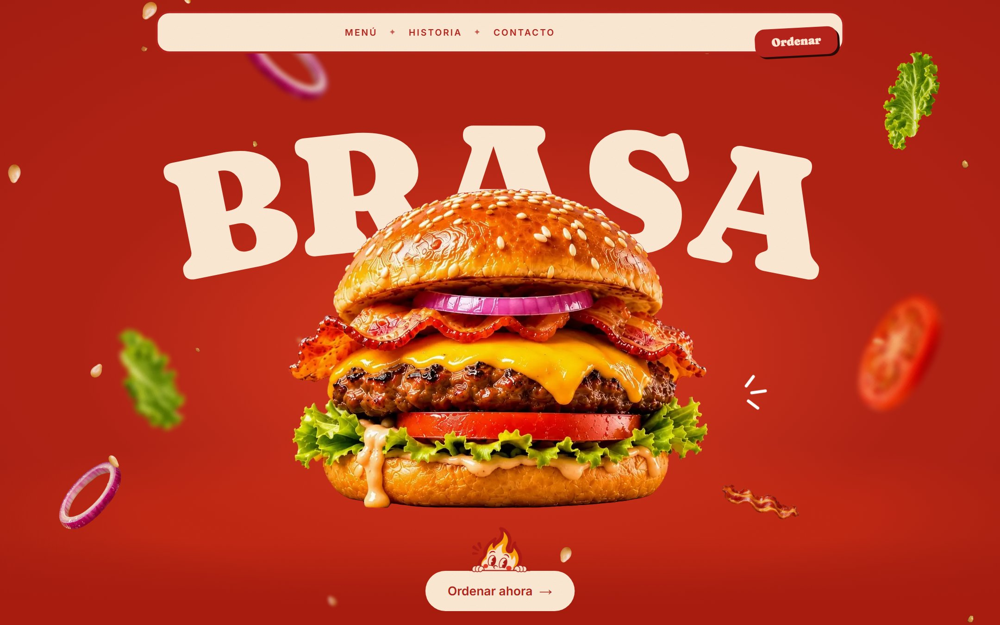
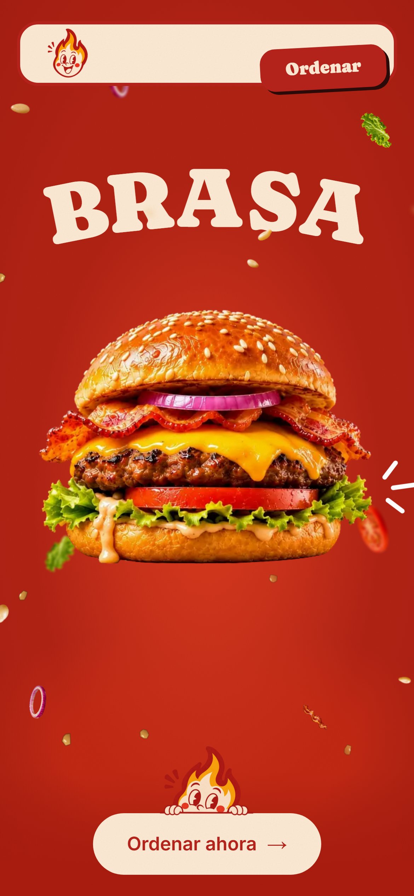

<div align="center">

# Brasa & Co. · A landing page for a burger joint

**The burger builds itself as you scroll.**
A concept site for a fictional burger restaurant in Barranquilla: every ingredient falls into place while you scroll, then the menu, the story and a one-tap WhatsApp order.

[**Visit the demo →**](https://jesusgabri3l.github.io/restaurante-brasa/)

<br />



</div>

## Overview

Part of **WEB PARA**, a series of demo sites for local businesses. Brasa & Co. is not a real restaurant: the name, menu, prices and WhatsApp number are made up.

<table>
  <tr>
    <td align="center" width="40%"><br /><sub>The hero on a phone</sub></td>
    <td width="60%">

- **Hero:** a 198-frame image sequence of the burger assembling itself, scrubbed by scroll.
- **Menu:** tabs for burgers, sides and drinks; a swipeable carousel on phones.
- **Story:** a looping grill video under dripping cheddar, with animated counters.
- **Order:** opening hours, address, map and a WhatsApp button with a pre-written message.

</td>
  </tr>
</table>

## How it's built

**Astro 7** (static) · **GSAP** ScrollTrigger · Lenis · Sass · TypeScript · GitHub Pages.

- **A video turned into a canvas.** The burger is an AI-generated clip (Kling) cut into frames, with the background removed by combining two rembg models: BiRefNet keeps the lettuce edges sharp, ISNet fills what the motion blur leaves behind. The frames ship as WebP (1080 px on desktop, 640 px on phones) and are drawn on a `<canvas>` as you scroll.
- **Frames load in the order you need them.** First and last frame, then every fourth, then the rest, six downloads at a time. Each one is decoded before it is drawn, so scrolling never stops to decode an image.
- **The title paints first.** BRASA is the Largest Contentful Paint, so its entrance is plain CSS and does not wait for the JavaScript bundle.
- **Nothing loads early that you can't see.** The grill video only downloads and plays near the viewport, and images are sized to how big they are actually shown.
- **Built for phones.** The hero uses `100lvh` so the iOS toolbar never uncovers the next section, and in iOS Low Power Mode the video waits for the first tap.
- **Accessible.** Readable contrast for yellow text on red, visible focus states, and with *reduce motion* the page shows the finished burger without animations.

## PageSpeed

<!-- pagespeed -->

## Development

Requires Node 22 or later.

```sh
npm install
npm run dev       # local server at http://localhost:4321
npm run build     # builds the site into ./dist/
npm run preview   # serves the build locally
```

`scripts/` holds the one-off asset pipeline (frame cutting, WebP conversion); the source files it reads stay out of the repo.

## Author

Jesús Ahumada — [Portfolio](https://jesusgabriel.dev/) · [LinkedIn](https://www.linkedin.com/in/jesus-ahumada) · [GitHub](https://github.com/jesusgabri3l)
